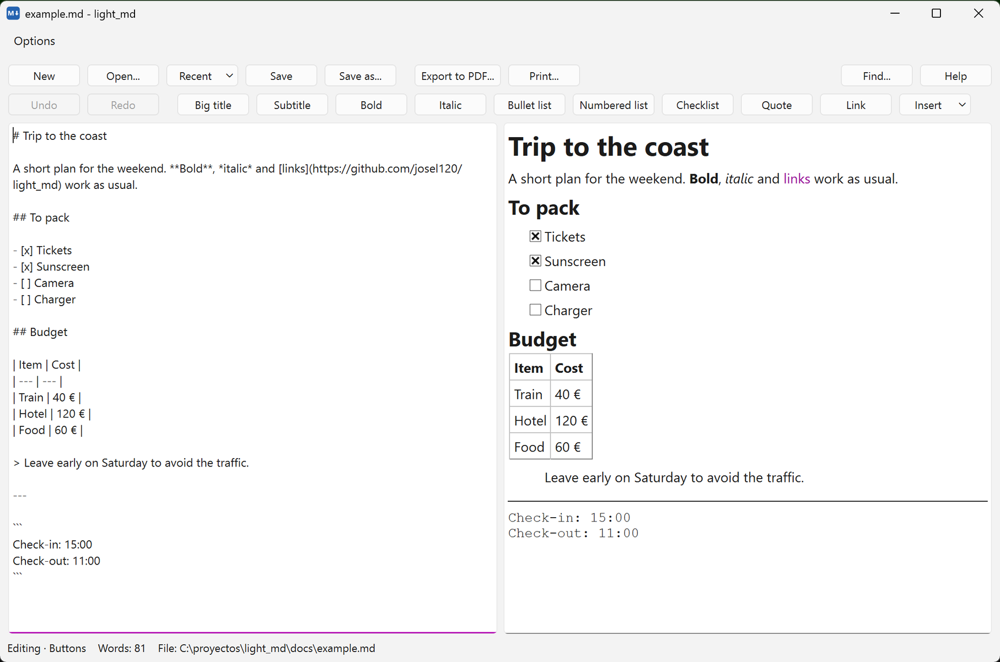

# light_md

[English](README.md) | [Español](README.es.md) | [Português](README.pt.md) | [Français](README.fr.md) | **Deutsch**

Ein schlanker Markdown-Editor in C++ und Qt 6, für alle.

Links schreiben, rechts sofort das formatierte Ergebnis sehen. Neu bei Markdown? Die Schaltflächen oben übernehmen die Formatierung für dich. Du kennst Markdown schon? Einfach lostippen, Tastenkürzel nutzen und weiter mit ganz normalen `.md`-Dateien arbeiten.



**[light_md für Windows herunterladen](https://github.com/josel120/light_md/releases/latest)**: Archiv entpacken und `bin\light_md.exe` öffnen. Keine Installation nötig.

> Die Oberfläche der Anwendung ist auf Englisch. Die Namen der Schaltflächen stehen unten so, wie sie auf dem Bildschirm erscheinen.

## Was es kann

- Zwei Bereiche: links schreiben, rechts lesen, mit sofortiger Vorschau.
- Schaltflächen mit Alltagswörtern: New (neu), Open (öffnen), Save (speichern), Big title (große Überschrift), Bold (fett), Bullet list (Aufzählung), Quote (Zitat), Link usw.
- Öffnet und speichert `.md`-Dokumente, auch per Drag-and-drop ins Fenster oder über „Öffnen mit“ im Datei-Explorer.
- Wörter suchen und ersetzen (Strg+F, Strg+H) und die letzten Dokumente über das Menü Recent (zuletzt verwendet) wieder öffnen.
- Checklisten sowie ein Insert-Menü (einfügen) für Bilder, Tabellen, Codeblöcke und Trennlinien. Bilder neben dem Dokument erscheinen in der Vorschau und im PDF.
- Bildschirmfotos und andere Bilder mit Strg+V einfügen: Sie werden in einem Ordner `images` neben dem Dokument gespeichert und erscheinen in der Vorschau und im PDF.
- Export als PDF und Drucken: Das Ergebnis sieht genauso aus wie der rechte Bereich.
- Rückgängig und Wiederholen sowie Tastenkürzel (Strg+S, Strg+Z, Strg+B, Strg+I, Strg+K, Strg+1, Strg+2).
- Öffnet beim Start das zuletzt geöffnete Dokument genau an der Stelle, an der du aufgehört hast (Cursor und Bildlauf), und merkt sich diese Stelle für jedes zuletzt verwendete Dokument.
- Text in beiden Bereichen größer oder kleiner mit Strg + Mausrad oder Strg+Plus / Strg+Minus (Strg+0 stellt die normale Größe wieder her). Die Größe wird gespeichert.
- Keine Arbeit geht verloren: Wenige Sekunden nach jeder Änderung legt light_md eine Wiederherstellungskopie an. Stürzt die App oder der Computer ab, bietet es beim nächsten Start an, die ungespeicherten Änderungen wiederherzustellen.
- Der Schreibbereich liest sich leichter: Überschriften sind größer, **fett** und *kursiv* sind sichtbar, Links und Code heben sich ab und Zitate sind abgedunkelt. Die Markdown-Zeichen bleiben sichtbar, in einer ruhigeren Farbe, und die Farben folgen dem Thema.
- Wortzähler und Warnung bei ungespeicherten Änderungen, auch beim Schließen des Fensters.
- Schaltfläche **Check for updates** (nach Updates suchen): meldet neue Versionen und lädt die passende Datei für dein System herunter.
- **macOS** (13 Ventura oder neuer): Ab Version 1.3 enthält jedes Release eine `macos.zip`. Entpacken und **light_md** in den Ordner Programme ziehen. Da die App noch nicht von Apple signiert ist, blockiert macOS sie beim ersten Start: **Systemeinstellungen → Datenschutz & Sicherheit** öffnen und **Trotzdem öffnen** klicken.
- Themenwahl: **System** (Desktop), **Minimal** (ruhiges helles Erscheinungsbild), **Dark** (sanftes dunkles Erscheinungsbild, Strg+Umschalt+4), **Omarchy** (folgt dem Omarchy-Thema unter Linux).
- Tastenkürzel: **Ctrl+Shift+B** Schaltflächen ein- oder ausblenden, **Ctrl+E** bearbeiten, **Ctrl+R** / **Esc** nur lesen; alles Weitere unter Options (Tabelle in [README.md](README.md)).
- Eine Help-Schaltfläche (Hilfe) mit einer kurzen Anleitung.

In [ROADMAP.md](ROADMAP.md) (auf Englisch) steht, was fertig ist und was als Nächstes kommt.

## Unter Linux kompilieren

Benötigt wird Qt 6 (`Widgets` und `PrintSupport`). Unter Arch / [Omarchy](https://omarchy.org/):

```bash
sudo pacman -S --needed base-devel cmake ninja qt6-base qt6-wayland
cmake -S . -B build -G Ninja -DCMAKE_BUILD_TYPE=Release
cmake --build build
./build/light_md
```

Zur Installation für deinen Benutzer (Binary, `.desktop`-Eintrag und Symbol für den Starter):

```bash
cmake --install build --prefix ~/.local
```

Beim ersten Start unter Omarchy ist **Omarchy** voreingestellt und aktualisiert sich beim Themenwechsel. Sonst startet es mit **System**. Die Wahl wird gespeichert.

## Kompilieren (Windows, mit Qt 6 und MinGW)

Du brauchst eine Qt-6-Installation (zum Beispiel in `C:\Qt`) mit dem mitgelieferten CMake und Ninja.

```powershell
$env:PATH = "C:\Qt\Tools\mingw1510_64\bin;C:\Qt\6.12.1\mingw_64\bin;$env:PATH"
C:\Qt\Tools\CMake_64\bin\cmake.exe -S . -B build -G Ninja -DCMAKE_PREFIX_PATH=C:/Qt/6.12.1/mingw_64
C:\Qt\Tools\CMake_64\bin\cmake.exe --build build
.\build\light_md.exe
```

Passe die Pfade an, falls deine Qt- oder MinGW-Version eine andere ist.

## Auf einen anderen Computer mitnehmen

So erstellst du einen Ordner, der auf jedem Windows-PC ohne Qt-Installation läuft:

```powershell
C:\Qt\Tools\CMake_64\bin\cmake.exe --install build --prefix dist
```

Kopiere den kompletten Ordner `dist` und öffne `dist\bin\light_md.exe`.

## Lizenz

MIT

Die Omarchy-Themenverfolgung folgt dem Ansatz von Omacut (MIT, David Heinemeier Hansson).
