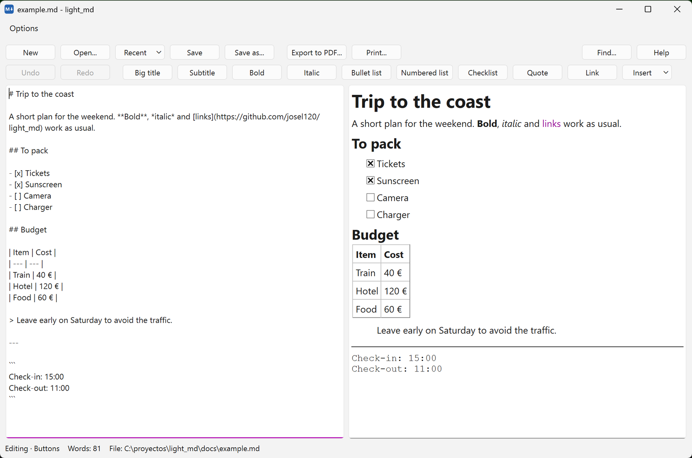

# light_md

[English](README.md) | **Español** | [Português](README.pt.md) | [Français](README.fr.md) | [Deutsch](README.de.md)

Un editor de Markdown ligero en C++ y Qt 6, abierto a todo tipo de usuarios.

Escribe a la izquierda y ve el resultado formateado a la derecha, al instante. ¿Nunca has usado Markdown? Los botones de arriba dan el formato por ti. ¿Ya lo dominas? Escribe directamente, usa los atajos de teclado y sigue trabajando con archivos `.md` normales.



**[Descargar light_md para Windows](https://github.com/josel120/light_md/releases/latest)**: descomprime el archivo y abre `bin\light_md.exe`. No hay que instalar nada.

> La interfaz de la aplicación está en inglés. Los nombres de los botones aparecen abajo tal como se ven en pantalla.

## Qué hace

- Dos paneles: escritura a la izquierda y lectura a la derecha, con vista previa al instante.
- Botones con palabras sencillas: New (nuevo), Open (abrir), Save (guardar), Big title (título grande), Bold (negrita), Bullet list (lista con puntos), Quote (cita), Link (enlace), etc.
- Abre y guarda documentos `.md`, también arrastrándolos a la ventana o con "Abrir con" desde el Explorador de archivos.
- Exporta a PDF e imprime: el resultado se ve igual que el panel derecho.
- Deshacer y rehacer, y atajos de teclado (Ctrl+S, Ctrl+Z, Ctrl+B, Ctrl+I, Ctrl+K, Ctrl+1, Ctrl+2).
- Contador de palabras y aviso de cambios sin guardar, también al cerrar la ventana.
- Selector de tema: **System** (escritorio), **Minimal** (aspecto claro y sobrio), **Omarchy** (sigue el tema Omarchy en Linux).
- Atajos: **Ctrl+E** editar, **Ctrl+R** / **Esc** solo lectura; el resto está en Options (ver tabla en [README.md](README.md)).
- Botón Help (ayuda) con una guía corta.

## Compilar en Linux

Hace falta Qt 6 (`Widgets` y `PrintSupport`). En Arch / [Omarchy](https://omarchy.org/):

```bash
sudo pacman -S --needed base-devel cmake ninja qt6-base qt6-wayland
cmake -S . -B build -G Ninja -DCMAKE_BUILD_TYPE=Release
cmake --build build
./build/light_md
```

Para instalarlo en tu usuario (binario, entrada `.desktop` e icono para el lanzador):

```bash
cmake --install build --prefix ~/.local
```

En el primer arranque bajo Omarchy, el tema por defecto es **Omarchy** y se actualiza al cambiar de tema. En el resto de sistemas, el valor inicial es **System**. La elección se recuerda.

## Compilar (Windows, con Qt 6 y MinGW)

Necesitas Qt 6 instalado (por ejemplo en `C:\Qt`) con su CMake y Ninja.

```powershell
$env:PATH = "C:\Qt\Tools\mingw1510_64\bin;C:\Qt\6.12.1\mingw_64\bin;$env:PATH"
C:\Qt\Tools\CMake_64\bin\cmake.exe -S . -B build -G Ninja -DCMAKE_PREFIX_PATH=C:/Qt/6.12.1/mingw_64
C:\Qt\Tools\CMake_64\bin\cmake.exe --build build
.\build\light_md.exe
```

Ajusta las rutas si tu versión de Qt o de MinGW es otra.

## Llevarlo a otro equipo (Windows)

Para crear una carpeta que funcione en cualquier PC con Windows sin instalar Qt:

```powershell
C:\Qt\Tools\CMake_64\bin\cmake.exe --install build --prefix dist
```

Copia la carpeta `dist` completa y abre `dist\bin\light_md.exe`.

## Licencia

MIT

El seguimiento del tema Omarchy sigue el enfoque de Omacut (MIT, David Heinemeier Hansson).
