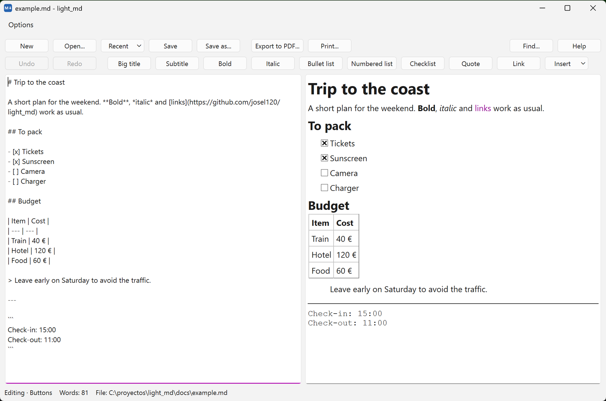

# light_md

[English](README.md) | [Español](README.es.md) | [Português](README.pt.md) | **Français** | [Deutsch](README.de.md)

Un éditeur Markdown léger en C++ et Qt 6, ouvert à tous les utilisateurs.

Écrivez à gauche et voyez le résultat mis en forme à droite, instantanément. Vous découvrez Markdown ? Les boutons en haut s'occupent de la mise en forme pour vous. Vous le maîtrisez déjà ? Tapez directement, utilisez les raccourcis clavier et continuez à travailler avec de simples fichiers `.md`.



**[Télécharger light_md pour Windows](https://github.com/josel120/light_md/releases/latest)** : décompressez l'archive et ouvrez `bin\light_md.exe`. Rien à installer.

> L'interface de l'application est en anglais. Les noms des boutons sont indiqués ci-dessous tels qu'ils apparaissent à l'écran.

## Ce qu'il fait

- Deux volets : écriture à gauche, lecture à droite, avec un aperçu instantané.
- Des boutons aux mots simples : New (nouveau), Open (ouvrir), Save (enregistrer), Big title (grand titre), Bold (gras), Bullet list (liste à puces), Quote (citation), Link (lien), etc.
- Ouvre et enregistre des documents `.md`, y compris par glisser-déposer sur la fenêtre ou via « Ouvrir avec » dans l'Explorateur de fichiers.
- Rechercher et remplacer des mots (Ctrl+F, Ctrl+H), et rouvrir vos derniers documents depuis le menu Recent (récents).
- Listes de tâches (Checklist) et un menu Insert (insérer) pour les images, tableaux, blocs de code et lignes de séparation. Les images placées à côté du document s'affichent dans l'aperçu et dans le PDF.
- Export en PDF et impression : le résultat est identique au volet de droite.
- Annuler et rétablir, plus des raccourcis clavier (Ctrl+S, Ctrl+Z, Ctrl+B, Ctrl+I, Ctrl+K, Ctrl+1, Ctrl+2).
- Compteur de mots et avertissement en cas de modifications non enregistrées, y compris à la fermeture de la fenêtre.
- Un bouton Help (aide) avec un guide court.

Voir [ROADMAP.md](ROADMAP.md) (en anglais) pour ce qui est fait et ce qui arrive ensuite.

## Compiler (Windows, avec Qt 6 et MinGW)

Il vous faut Qt 6 installé (par exemple dans `C:\Qt`) avec son CMake et son Ninja.

```powershell
$env:PATH = "C:\Qt\Tools\mingw1510_64\bin;C:\Qt\6.12.1\mingw_64\bin;$env:PATH"
C:\Qt\Tools\CMake_64\bin\cmake.exe -S . -B build -G Ninja -DCMAKE_PREFIX_PATH=C:/Qt/6.12.1/mingw_64
C:\Qt\Tools\CMake_64\bin\cmake.exe --build build
.\build\light_md.exe
```

Adaptez les chemins si votre version de Qt ou de MinGW est différente.

## L'emporter sur un autre ordinateur

Pour créer un dossier qui fonctionne sur n'importe quel PC Windows sans installer Qt :

```powershell
C:\Qt\Tools\CMake_64\bin\cmake.exe --install build --prefix dist
```

Copiez tout le dossier `dist` et ouvrez `dist\bin\light_md.exe`.

## Licence

MIT
