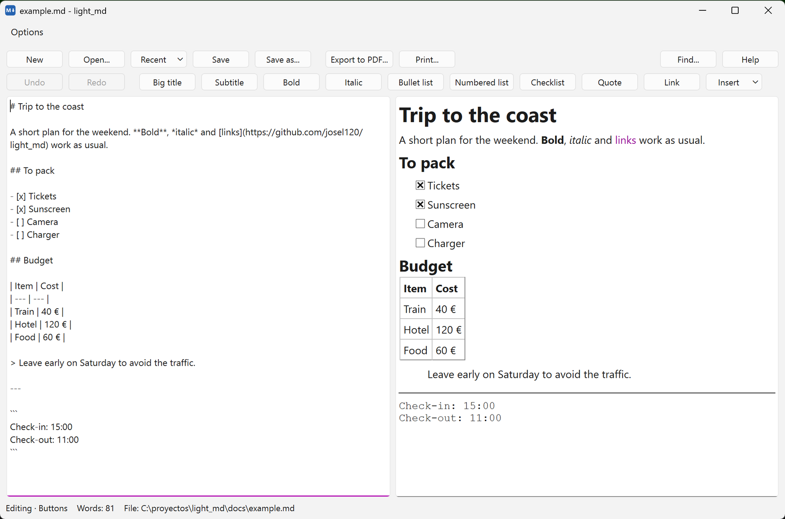

# light_md

**English** | [Español](README.es.md) | [Português](README.pt.md) | [Français](README.fr.md) | [Deutsch](README.de.md)

A lightweight Markdown editor in C++ and Qt 6, for everyone.

Write on the left, see the formatted result on the right. Format with the buttons at the top — no Markdown required. Prefer a quieter layout? Hide the buttons with **Ctrl+Shift+B**, or use **Options** (every action has a shortcut).



**[Download light_md](https://github.com/josel120/light_md/releases/latest)**:

- **Windows**: download the `windows-x64.zip`, unzip it and open `bin\light_md.exe`. Nothing to install.
- **macOS** (13 Ventura or later, Apple Silicon and Intel; from version 1.3): download the `macos.zip`, unzip it and drag **light_md** to Applications. The app is not signed by Apple yet, so the first time macOS blocks it: open **System Settings → Privacy & Security** and click **Open Anyway**.
- **Linux**: build from source (below) or use the Arch `PKGBUILD`.

## What it does

- **Classic layout by default**: file and format button bars plus write + preview panes.
- Toggle **Show buttons** (**Ctrl+Shift+B**) for a minimal Options-only chrome.
- Optional **Reader** mode (**Ctrl+E** / **Ctrl+R** / **Esc**) hides the writing pane; independent of the button bars.
- Button visibility and the last Edit/Reader view are remembered across restarts and when opening another file.
- **Options** menu in everyday words: New, Open, Save, Format, Theme, Help — every item has a shortcut.
- Open and save `.md` documents, also by dragging them onto the window or using "Open with" from the file manager.
- Find and replace words (Ctrl+F, Ctrl+H), and reopen your latest documents from the Recent menu.
- Checklists, plus an Insert menu for pictures, tables, code blocks and separator lines. Pictures next to your document show up in the preview and the PDF.
- Paste a screenshot or any picture with Ctrl+V: it is saved in an `images` folder next to your document and shows up in the preview and the PDF.
- Export to PDF and print: the result looks just like the reading pane.
- Reopens the document you had open last time, right where you left off (cursor and scroll), and remembers that spot for each recent document.
- Make the text bigger or smaller in both panes with Ctrl + mouse wheel or Ctrl+Plus / Ctrl+Minus (Ctrl+0 goes back to normal). The size is remembered.
- Never lose your work: a few seconds after each change, light_md keeps a recovery copy. If the app or the computer crashes, it offers to restore your unsaved changes the next time you open it.
- The writing pane is easier to read: titles are bigger, **bold** and *italic* look the part, links and code stand out and quotes are dimmed. The Markdown symbols stay visible, in a quieter color, and the colors follow the theme.
- Word count and an unsaved-changes warning, including when closing the window.
- **Check for updates** button: tells you when a new version is out and downloads the right file for your system.
- Themes: **System** (desktop default), **Minimal** (quiet light look), **Dark** (soft dark look, Ctrl+Shift+4), **Omarchy** (live desktop theme on Omarchy Linux only). Windows and macOS keep **System** by default.

See [ROADMAP.md](ROADMAP.md) for what is done and what is coming next.

## Keyboard shortcuts

| Action | Shortcut |
| --- | --- |
| Show / hide buttons | Ctrl+Shift+B |
| Edit document | Ctrl+E |
| Read only | Ctrl+R or Esc |
| New / Open / Save / Save as | Ctrl+N / Ctrl+O / Ctrl+S / Ctrl+Shift+S |
| Export PDF / Print | Ctrl+Shift+E / Ctrl+P |
| Undo / Redo | Ctrl+Z / Ctrl+Shift+Z (or Ctrl+Y) |
| Bold / Italic / Link | Ctrl+B / Ctrl+I / Ctrl+K |
| Big title / Subtitle | Ctrl+1 / Ctrl+2 |
| Bullet / Numbered / Checklist / Quote | Ctrl+Shift+8 / Ctrl+Shift+7 / Ctrl+Shift+9 / Ctrl+Shift+. |
| Insert picture / table / code block / separator line | Ctrl+Shift+P / Ctrl+Shift+T / Ctrl+Shift+C / Ctrl+Shift+L |
| Bigger / smaller / normal text | Ctrl++ (or Ctrl+=) / Ctrl+- / Ctrl+0, or Ctrl + mouse wheel |
| Find / Replace | Ctrl+F / Ctrl+H (Esc closes the find bar) |
| Next / previous match | F3 / Shift+F3 |
| Theme System / Minimal / Omarchy / Dark | Ctrl+Shift+1 / Ctrl+Shift+2 / Ctrl+Shift+3 / Ctrl+Shift+4 |
| Help | F1 |

On macOS, use **Cmd** instead of Ctrl where the platform expects it (standard Qt shortcuts).

## Build on macOS

Install Qt 6 (for example with the [Qt online installer](https://www.qt.io/download-qt-installer) or `brew install qt`) and the Xcode command line tools, then:

```bash
cmake -S . -B build -DCMAKE_BUILD_TYPE=Release -DCMAKE_PREFIX_PATH="$(brew --prefix qt)"
cmake --build build
cmake --install build --prefix dist   # creates dist/light_md.app with Qt included
```

The macOS and Windows packages of each release are built automatically by GitHub Actions (`.github/workflows/build.yml`).

## Build on Linux

Needs Qt 6 development packages (`Widgets`, `PrintSupport` and `Network`). On Arch / [Omarchy](https://omarchy.org/):

```bash
sudo pacman -S --needed base-devel cmake ninja qt6-base qt6-wayland
cmake -S . -B build -G Ninja -DCMAKE_BUILD_TYPE=Release
cmake --build build
./build/light_md
```

Install for your user (binary, `.desktop` entry, and icon):

```bash
cmake --install build --prefix ~/.local
```

Or build an Arch package of the latest release with `packaging/arch/PKGBUILD` (`makepkg -si` in that folder).

On first launch under Omarchy, the theme defaults to **Omarchy** and updates when you run `omarchy theme set`. Elsewhere it defaults to **System**. Your choice is remembered.

## Build on Windows (Qt 6 and MinGW)

You need Qt 6 installed (for example in `C:\Qt`) with its CMake and Ninja.

```powershell
$env:PATH = "C:\Qt\Tools\mingw1510_64\bin;C:\Qt\6.12.1\mingw_64\bin;$env:PATH"
C:\Qt\Tools\CMake_64\bin\cmake.exe -S . -B build -G Ninja -DCMAKE_PREFIX_PATH=C:/Qt/6.12.1/mingw_64
C:\Qt\Tools\CMake_64\bin\cmake.exe --build build
.\build\light_md.exe
```

Adjust the paths if your Qt or MinGW version is different.

## Take it to another Windows computer

To create a folder that runs on any Windows PC without installing Qt:

```powershell
C:\Qt\Tools\CMake_64\bin\cmake.exe --install build --prefix dist
```

Copy the whole `dist` folder and open `dist\bin\light_md.exe`.

## Run the tests

The formatting buttons, find and replace, the syntax highlighting and reopening a document where you left off have unit tests (Qt Test, in `tests/`). CI runs them on Windows, macOS and Linux for every push. To run them yourself, turn them on when configuring and use `ctest`:

```
cmake -S . -B build -DLIGHT_MD_TESTS=ON
cmake --build build
ctest --test-dir build --output-on-failure
```

## License

MIT

Omarchy theme watching follows the approach used in Omacut (MIT, David Heinemeier Hansson).
