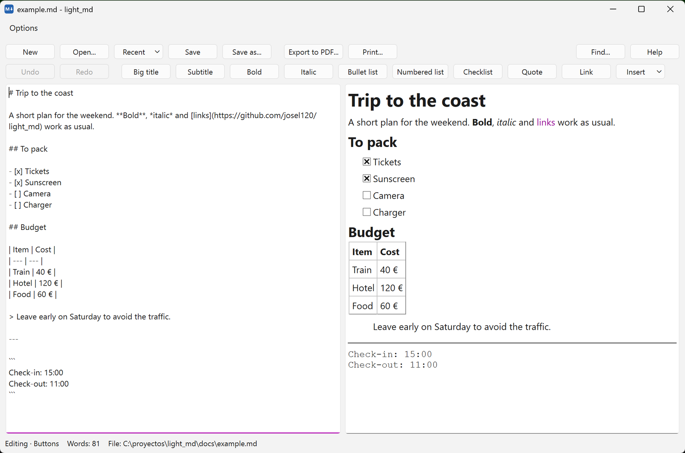

# light_md

[English](README.md) | [Español](README.es.md) | **Português** | [Français](README.fr.md) | [Deutsch](README.de.md)

Um editor de Markdown leve em C++ e Qt 6, para todo tipo de usuário.

Escreva à esquerda e veja o resultado formatado à direita, na hora. Nunca usou Markdown? Os botões no topo fazem a formatação por você. Já domina? É só digitar, usar os atalhos de teclado e continuar trabalhando com arquivos `.md` comuns.



**[Baixar o light_md para Windows](https://github.com/josel120/light_md/releases/latest)**: descompacte o arquivo e abra `bin\light_md.exe`. Não é preciso instalar nada.

> A interface do aplicativo está em inglês. Os nomes dos botões aparecem abaixo exatamente como são exibidos na tela.

## O que ele faz

- Dois painéis: escrita à esquerda e leitura à direita, com pré-visualização instantânea.
- Botões com palavras simples: New (novo), Open (abrir), Save (salvar), Big title (título grande), Bold (negrito), Bullet list (lista com marcadores), Quote (citação), Link etc.
- Abre e salva documentos `.md`, inclusive arrastando-os para a janela ou usando "Abrir com" no Explorador de Arquivos.
- Localizar e substituir palavras (Ctrl+F, Ctrl+H) e reabrir seus últimos documentos pelo menu Recent (recentes).
- Listas de tarefas (Checklist) e um menu Insert (inserir) para imagens, tabelas, blocos de código e linhas separadoras. As imagens ao lado do documento aparecem na pré-visualização e no PDF.
- Exporta para PDF e imprime: o resultado fica igual ao painel da direita.
- Desfazer e refazer, além de atalhos de teclado (Ctrl+S, Ctrl+Z, Ctrl+B, Ctrl+I, Ctrl+K, Ctrl+1, Ctrl+2).
- Contador de palavras e aviso de alterações não salvas, inclusive ao fechar a janela.
- Botão Help (ajuda) com um guia curto.

Veja [ROADMAP.md](ROADMAP.md) (em inglês) para saber o que já está pronto e o que vem a seguir.

## Compilar (Windows, com Qt 6 e MinGW)

Você precisa do Qt 6 instalado (por exemplo em `C:\Qt`) com o CMake e o Ninja dele.

```powershell
$env:PATH = "C:\Qt\Tools\mingw1510_64\bin;C:\Qt\6.12.1\mingw_64\bin;$env:PATH"
C:\Qt\Tools\CMake_64\bin\cmake.exe -S . -B build -G Ninja -DCMAKE_PREFIX_PATH=C:/Qt/6.12.1/mingw_64
C:\Qt\Tools\CMake_64\bin\cmake.exe --build build
.\build\light_md.exe
```

Ajuste os caminhos se a sua versão do Qt ou do MinGW for diferente.

## Levar para outro computador

Para criar uma pasta que funcione em qualquer PC com Windows sem instalar o Qt:

```powershell
C:\Qt\Tools\CMake_64\bin\cmake.exe --install build --prefix dist
```

Copie a pasta `dist` inteira e abra `dist\bin\light_md.exe`.

## Licença

MIT
